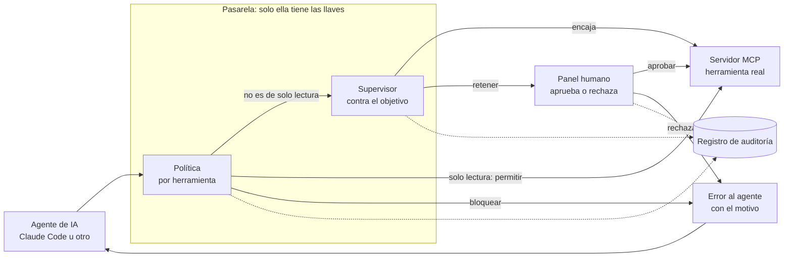

# Visión de producto: Holdpoint, torre de control para agentes de IA

## Resumen

La torre de control es una pasarela entre los agentes de IA y las herramientas que usan a través de MCP. Decide qué pueden hacer solos y qué necesita el visto bueno de una persona.

Para cada llamada aplica una política (permitir, bloquear o pedir aprobación), comprueba con un supervisor si encaja con la tarea pedida al agente y lo registra todo para poder reproducir la sesión.

El producto se llama Holdpoint, con el lema «where AI agents wait for clearance». En aviación, el holding point es donde el avión espera a que la torre le autorice a entrar en pista, igual que una llamada retenida. El nombre no lleva MCP porque la evolución prevista va más allá. Es el proyecto final del curso AI4Devs de LIDR.

## Problema

Hoy, un agente con un servidor MCP conectado puede usar todas sus herramientas cuando quiera: el acceso es todo o nada.

- Los permisos de clientes como Claude Code son locales: los decide cada desarrollador en su máquina y los aprueba él mismo.
- No hay un registro común de qué hizo cada agente, con qué argumentos y quién lo autorizó.
- Un error de criterio del agente, como borrar lo que no debía, se descubre cuando ya está hecho.

## Usuarios y escenario

El cliente es un equipo de desarrollo que ya deja trabajar a agentes contra sistemas reales.

| Usuario | Qué hace en el producto |
| --- | --- |
| Administrador (tech lead) | Registra los servidores MCP y define la política de cada herramienta |
| Responsable | Aprueba o rechaza en tiempo real las llamadas retenidas |
| Auditor | Reproduce sesiones para ver qué hizo cada agente y quién lo autorizó |
| Agente de IA | Llama a las herramientas a través de la pasarela, sin ver las credenciales reales |

**Escenario.** Se le pide a un agente «limpia los tickets duplicados del proyecto». Las búsquedas pasan solas. Cuando intenta borrar un ticket, la llamada queda retenida y el responsable ve en el panel qué ticket quiere borrar, junto con el veredicto del supervisor. Si la rechaza, el agente recibe el motivo («no es duplicado, es otro navegador») y ajusta su plan. Al terminar, la sesión entera se puede reproducir paso a paso.

## Qué hace el producto

Las llamadas de solo lectura pasan directas. El resto pasa por la política de su herramienta y por el supervisor, y solo llega al servidor real si los dos lo permiten o si una persona la aprueba.

Lo que la política bloquea vuelve al agente como error con su motivo. Lo que la política manda aprobar, o lo que el supervisor ve que no encaja con la tarea, queda retenido en el panel hasta que alguien decide o caduca. Todo queda en el registro de auditoría.

## Alcance del MVP

El MVP son cinco historias imprescindibles, y cada una recorre el panel, la API, la pasarela y la base de datos.

1. **Registrar un servidor.** Como administrador, registro un servidor MCP detrás de la pasarela y veo sus herramientas.
2. **Políticas.** Como administrador, decido para cada herramienta si se permite, se bloquea o pide aprobación. La política inicial se propone según el riesgo que declara cada herramienta.
3. **Aprobación en tiempo real.** Como responsable, apruebo o rechazo las llamadas retenidas viendo sus argumentos. Si nadie decide a tiempo, la llamada caduca. Al aprobar, puedo permitir esa herramienta durante el resto de la sesión para que no vuelva a preguntar.
4. **Supervisor de intención.** Como responsable, sé si cada llamada encaja con el objetivo declarado de la sesión. El supervisor evalúa las llamadas que no son de solo lectura: si una no encaja, se retiene aunque la política la permita, y en las retenidas su veredicto acompaña a la solicitud.
5. **Reproducir una sesión.** Como auditor, recorro una sesión paso a paso: qué pidió el agente, qué se decidió, quién lo decidió y qué devolvió la herramienta.

**Deseables (no obligatorias):**

- Freno automático si un agente entra en bucle, por ejemplo demasiados borrados por minuto.
- Un hook de Claude Code que envíe también las herramientas propias del agente (terminal, edición de ficheros) a la misma bandeja de aprobaciones.

## Fuera de alcance del MVP

El MVP se limita a lo mínimo para demostrar el flujo completo; esto queda fuera:

- Transporte stdio: solo HTTP.
- Recursos y prompts de MCP: solo herramientas.
- Más de un servidor MCP real: uno de ejemplo hecho para la demo, un gestor de tareas.
- OAuth: credenciales fijas de prueba.
- Inspeccionar lo que devuelven las herramientas para detectar instrucciones inyectadas: línea futura.
- Peticiones con credenciales de usuario: que cada agente se identifique como una persona o un rol, y que las políticas dependan de quién pide (por ejemplo, el agente del tech lead borra en preproducción sin aprobación). Línea futura; esa lista blanca se saltaría a la persona, nunca al supervisor ni al freno por volumen.
- Torre local: un componente de la torre en el portátil que arranca también los servidores MCP locales del usuario, para que pasen por las políticas, el supervisor y la auditoría. Ampliación prevista; como las credenciales locales seguirían en la máquina, daría aprobación y auditoría, no una garantía.
- Multiempresa, despliegue en la nube y alta disponibilidad.

## Principios de diseño

Ocho decisiones de partida guían la arquitectura de la entrega 1:

1. **La pasarela es la única con llaves.** Solo ella tiene las credenciales de los servicios reales y llega a la red donde viven los servidores MCP, así que el agente no puede saltársela.
2. **La persona es la excepción.** Las herramientas de solo lectura se permiten, las destructivas piden aprobación y el resto pasa por el supervisor, según las anotaciones de MCP (readOnlyHint, destructiveHint). Una herramienta sin anotar pide aprobación hasta que el administrador la clasifica, una sola vez.
3. **Espera con tiempo máximo.** La llamada retenida se mantiene abierta un tiempo fijo, por ejemplo 60 segundos. Sin decisión, caduca y el agente recibe un error claro. El valor exacto sale de la prueba de concepto.
4. **Todo queda registrado, sin secretos.** Cada llamada, decisión y respuesta se guarda, y los argumentos sensibles se ocultan antes de escribirlos.
5. **Objetivo declarado.** Al empezar la sesión, el agente declara su tarea con una herramienta propia de la pasarela, y el supervisor compara cada llamada con ese objetivo. A confirmar en la prueba de concepto.
6. **Funciona sin cuentas externas.** Todo arranca con docker-compose, y el supervisor tiene modo simulado o con Ollama para no depender de claves de API.
7. **Claude Code, con catálogo aprobado.** En las máquinas de los desarrolladores, la configuración gestionada (managed-settings.json) entrega la torre a todos con managedMcpServers y limita los demás servidores MCP a un catálogo aprobado (allowedMcpServers con allowManagedMcpServersOnly). No se despliega managed-mcp.json, que bloquearía también los servidores locales. En el MVP se documenta con un fichero de ejemplo, sin implementarlo.
8. **Multiplataforma: Windows y Linux.** La torre se ejecuta con docker-compose en Linux y en Windows con Docker Desktop. En la parte de cliente solo cambia la ruta de la configuración gestionada: `C:\Program Files\ClaudeCode\` en Windows y `/etc/claude-code/` en Linux y WSL. El desarrollo se hace en WSL, y la integración continua compila y pasa los tests unitarios en Linux y en Windows, y el E2E en Linux.

**Stack previsto:** .NET 10 con el SDK oficial de MCP para C#, React con Vite, PostgreSQL y SignalR para el panel en tiempo real.

## Supuestos a validar: la prueba de concepto

La prueba de concepto valida que la pasarela, la pieza de la que depende todo, se puede construir como se ha descrito. Presupuesto: 6-10 horas, con decisión el jueves 26 de noviembre.

**Qué se construye:** un proxy que solo deja pasar las llamadas, con el SDK oficial de MCP para C#, un servidor de ejemplo con una herramienta y Claude Code conectado a la pasarela. Se guarda fuera de la rama de la entrega 1, que debe ser solo documentación. Si sale bien, es la base del esqueleto de la entrega 2.

| # | Comprobación | Peso |
| --- | --- | --- |
| 1 | Claude Code, conectado a la pasarela, ve las herramientas del servidor de ejemplo | Bloqueante |
| 2 | Una llamada atraviesa la pasarela, llega al servidor y el resultado vuelve a Claude Code | Bloqueante |
| 3 | La pasarela deja constancia de la llamada, aunque sea en consola | Esperado |
| 4 | La pasarela devuelve un error propio («bloqueada por política») y Claude Code reacciona a él | Esperado |
| 5 | Se sabe cuánto espera Claude Code antes de cortar, probando retardos de 30, 60 y 120 segundos | Define el diseño de la espera |

**Decisión:** con 1 a 4 en verde, se sigue con la torre de control. Si el 26 de noviembre fallan el 1 o el 2, se cambia a otra propuesta (el oído de la casa o el triaje de incidencias), que aún da tiempo a documentar. Si los puntos 1 y 2 funcionan el primer día, la decisión se puede adelantar.

**Lo que no valida:** la calidad del supervisor, que se prueba aparte con casos de «tarea + llamada», ni los casos límite de concurrencia, que se resuelven al diseñar la máquina de estados de la llamada.

## Criterios de éxito y calendario

El MVP está terminado cuando estas cinco comprobaciones se cumplen en la entrega final:

- Un agente con guion fijo intenta borrar una tarea, la llamada queda retenida, se aprueba desde el panel y el agente recibe el resultado (test E2E).
- Una llamada directa al servidor MCP, sin pasar por la pasarela, falla (test de seguridad).
- El supervisor marca como «no encaja» las llamadas contrarias al objetivo en un conjunto de casos de prueba.
- Quien evalúa lo arranca con docker-compose, datos de prueba y un `.env.example`, sin preguntar nada.
- La sesión de la demo se puede reproducir entera desde el panel, y el panel muestra qué parte de las llamadas necesitó a una persona.

**Calendario de la entrega 1:**

| Fechas | Hito |
| --- | --- |
| 23 a 25 nov 2026 | Prueba de concepto |
| 26 nov 2026 | Decisión: seguir con la torre de control o cambiar de propuesta |
| 26 a 30 nov 2026 | Documentación de la entrega 1 |
| 1 a 2 dic 2026 | Repaso de coherencia entre arquitectura, datos, API y tickets |
| 3 dic 2026 | Rama de la entrega y Typeform |
| 4 dic 2026 | Fecha límite de la entrega 1 |

La decisión del 26 de noviembre es el punto de no retorno, y el envío se hace el 3 de diciembre para tener un día de margen. Las fechas de la entrega 2 y de la final están pendientes de confirmar.

## Entrega 2: código funcional

La entrega 2 pide código que haga algo real: al menos una historia que funcione de extremo a extremo. La primera candidata es la historia 1, registrar un servidor. La fecha está pendiente de confirmar.

**Qué exige la lección 2:**

- Readme.md y Prompts.md actualizados en el repo. Toda la documentación va en Markdown dentro del repo, también la de la entrega 1.
- Esqueleto conectado: panel, API, pasarela y base de datos, arrancando con docker-compose.
- Al menos una funcionalidad que haga algo real de extremo a extremo.
- Solo credenciales de prueba, con `.env.example` y sin secretos en el repo.
- Rama `feature/entrega-2-` seguida de las iniciales, y el Typeform. Sin pull request. El acceso de lectura para LIDR-AI4Devs solo hace falta si el repo es privado.

**Primera funcionalidad: registrar un servidor.** El administrador da de alta el servidor de ejemplo desde el panel. La pasarela se conecta a él, lee sus herramientas con sus anotaciones (readOnlyHint, destructiveHint), las guarda en PostgreSQL y el panel las muestra. Pasa por todas las capas, aprovecha la conexión de la prueba de concepto y prepara la historia 2, porque las políticas se definen sobre esas herramientas.

**Cómo se verifica:** docker-compose con datos de prueba para levantarlo en local, más un vídeo de 2-3 minutos del flujo. Una URL pública es opcional y aquí aporta poco: lo importante pasa entre el agente y la pasarela, y el supervisor con Ollama difícilmente cabe en un plan gratuito.

**Qué conviene adelantar:**

- Prompts.md: apuntar desde la prueba de concepto qué se pidió, qué falló y cómo se corrigió, por ejemplo métodos del SDK de MCP para C# que el modelo se invente.
- Tickets: dividir las cinco historias en tickets técnicos en GitHub Issues.
- CLAUDE.md: fijar la arquitectura del backend (por capas o hexagonal, por decidir) y reglas estrictas para React con TypeScript antes de generar código.
- Flujo por ticket: especificación, encaje en la arquitectura y, solo entonces, código.

## Glosario

| Término | Significado |
| --- | --- |
| MCP | Model Context Protocol: el estándar con el que los agentes de IA usan herramientas externas |
| Servidor MCP | Programa que ofrece herramientas a los agentes (por ejemplo, buscar o borrar tickets) |
| Herramienta | Una operación concreta de un servidor MCP que el agente puede llamar |
| Pasarela | El producto: se pone entre el agente y los servidores MCP y decide sobre cada llamada |
| Política | La regla de cada herramienta: permitir, bloquear o pedir aprobación |
| Supervisor | Componente con un LLM que comprueba si una llamada encaja con el objetivo de la sesión |
| Sesión | El trabajo de un agente sobre una tarea, con su objetivo declarado y todas sus llamadas |
| Llamada retenida | Una llamada que espera a que una persona la apruebe o la rechace, con un tiempo máximo |
